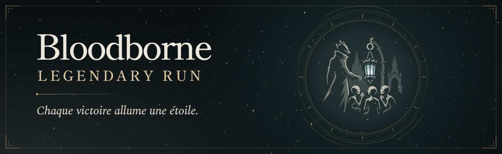
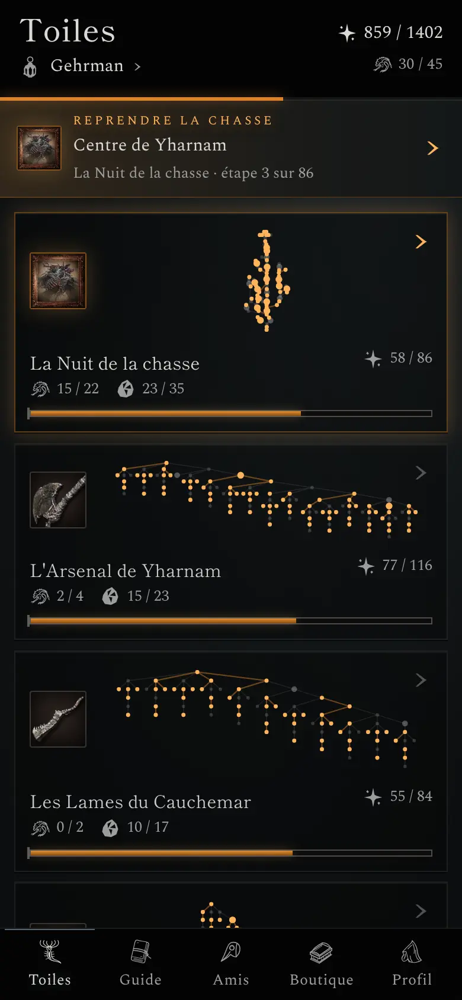
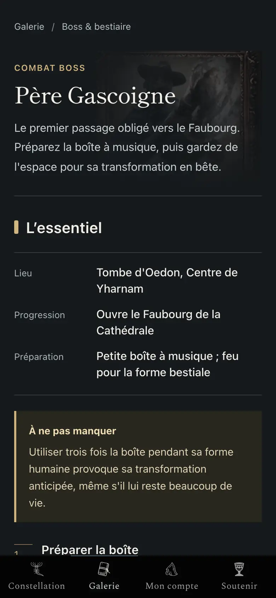
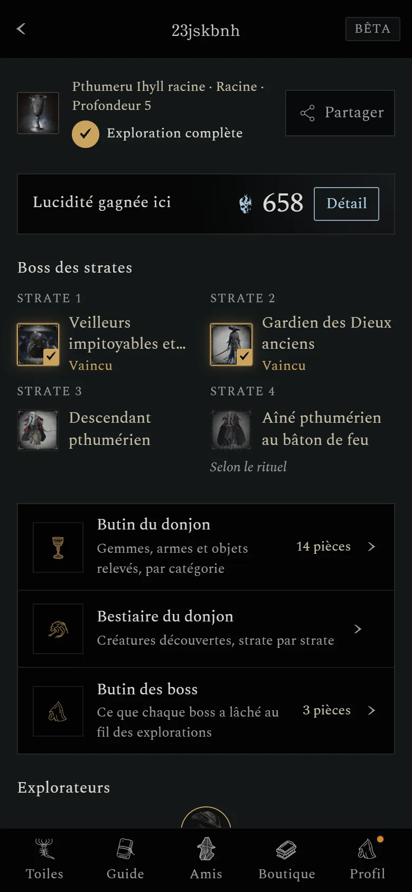

# Bloodborne Legendary Run

<picture>
  <source media="(max-width: 700px)" srcset="./assets/readme/banniere-mobile.jpg">
  
</picture>

**Un guide pour Bloodborne et un carnet de progression pour chaque chasseur.**

Choisissez une galaxie, relevez ses défis au fil de votre partie et retrouvez les fiches du Guide du chasseur quand vous en avez besoin.

**[Ouvrir le site officiel](https://bloodborne-legendary-run.com/fr)** · [Premiers pas](docs/premiers-pas.md) · [Contribuer](CONTRIBUTING.md)

## Préparer et suivre sa chasse

- **Constellation.** Chaque étoile correspond à un défi. Parcourez les galaxies et allumez les étoiles à mesure que vous validez leurs objectifs.
- **Runs par personnage.** Gardez une progression distincte pour chaque personnage et reprenez sa chasse là où vous l’avez laissée.
- **Guide du chasseur.** Consultez les fiches de boss, d’armes, de quêtes, de gemmes et de calices pendant votre partie.

[Explorer la constellation](https://bloodborne-legendary-run.com/fr/sky) · [Consulter le Guide du chasseur](https://bloodborne-legendary-run.com/fr/gallery)

  
  
  

*Captures du journal de l’application. Ouvrez une image pour la voir en pleine taille.*

## Accéder à l’application

| Accès | Où commencer |
| --- | --- |
| Web | [Ouvrir l’application dans le navigateur](https://bloodborne-legendary-run.com/fr) |
| Windows | [Télécharger depuis le site officiel](https://bloodborne-legendary-run.com/fr/download) |
| Android | [Consulter la bêta fermée](https://bloodborne-legendary-run.com/fr/beta), accessible sur invitation |

Les téléchargements officiels sont sur le site. Aucune version n’est actuellement publiée dans [GitHub Releases](https://github.com/LINDECKER-Charles/Bloodborne-Legendary-Run-public/releases).

## Communauté

- [Signaler un bug, corriger une fiche ou proposer une amélioration](https://github.com/LINDECKER-Charles/Bloodborne-Legendary-Run-public/issues/new/choose).
- [Poser une question, partager une run ou discuter d’une idée](https://github.com/LINDECKER-Charles/Bloodborne-Legendary-Run-public/discussions).
- Consulter le [guide de contribution](CONTRIBUTING.md), le [code de conduite](CODE_OF_CONDUCT.md) ou le [support](SUPPORT.md).

Bloodborne Legendary Run est un projet communautaire indépendant. Ce dépôt rassemble la documentation de distribution et les échanges GitHub. Le code de l’application est maintenu dans un dépôt distinct.

