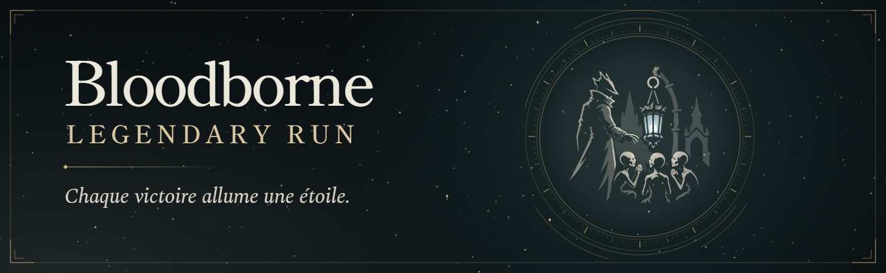
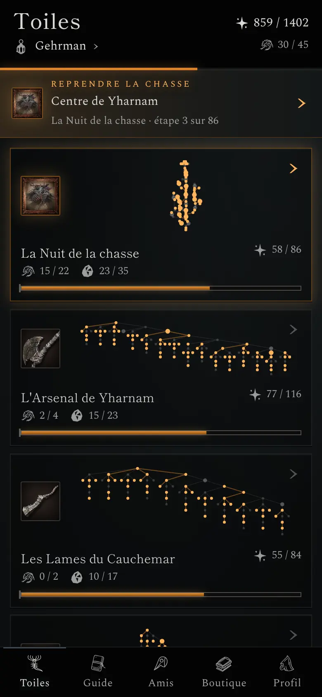
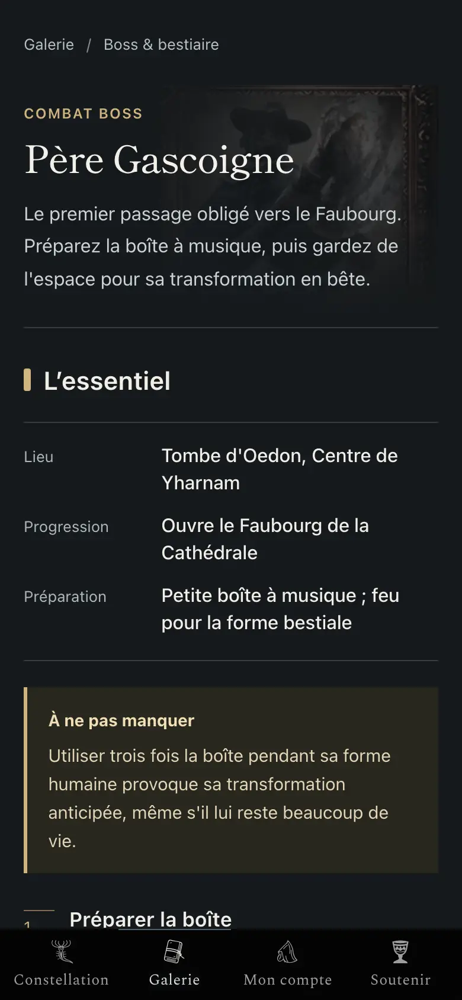
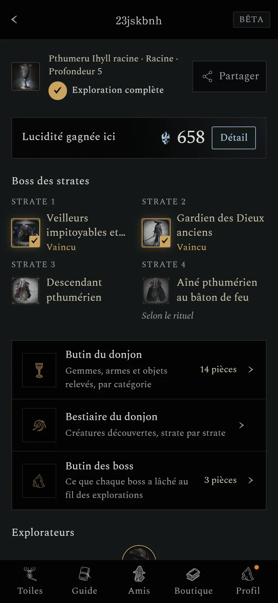

# Bloodborne Legendary Run

[Français](../../README.md) · **English**

<picture>
  <source media="(max-width: 700px)" srcset="../../assets/readme/banniere-mobile.jpg">
  
</picture>

**A Bloodborne guide and a progress tracker for every hunter.**

Choose a canvas, take on its challenges as you play, and look up entries in the Hunter’s Guide whenever you need them.

**[Open the official site](https://bloodborne-legendary-run.com/en)** · [Getting started](getting-started.md) · [Contribute](../../.github/en/CONTRIBUTING.md)

## Plan and track your hunt

- **Constellation.** Each star represents a challenge. Explore the canvases and light up stars as you complete their objectives.
- **Runs by character.** Track each character’s progress separately and pick up where you left off.
- **Hunter’s Guide.** Look up bosses, weapons, quests, blood gems, and chalice dungeons while you play.

[Explore the constellation](https://bloodborne-legendary-run.com/en/sky) · [Browse the Hunter’s Guide](https://bloodborne-legendary-run.com/en/gallery)

  
  
  

*These screenshots show the app in French and come from the development log. Open any image to see it at full size.*

## Access the app

| Platform | Where to start |
| --- | --- |
| Web | [Open the app in your browser](https://bloodborne-legendary-run.com/en) |
| Windows | [Download from the official site](https://bloodborne-legendary-run.com/en/download) |
| Android | [Learn about the invite-only closed beta](https://bloodborne-legendary-run.com/en/beta) |

Official downloads are available on the website. New versions are also published in [GitHub Releases](https://github.com/LINDECKER-Charles/Bloodborne-Legendary-Run-public/releases), with illustrated release notes and the Windows installer.

## Community

- [Report a bug, request a correction, or suggest an improvement](https://github.com/LINDECKER-Charles/Bloodborne-Legendary-Run-public/issues/new/choose).
- [Ask a question, share a run, or discuss an idea](https://github.com/LINDECKER-Charles/Bloodborne-Legendary-Run-public/discussions).
- Read the [contribution guide](../../.github/en/CONTRIBUTING.md), [code of conduct](../../.github/en/CODE_OF_CONDUCT.md), or [support guide](../../.github/en/SUPPORT.md).

Bloodborne Legendary Run is an independent community project. This repository hosts distribution documentation and community discussions. The application source code is maintained in a separate repository.
